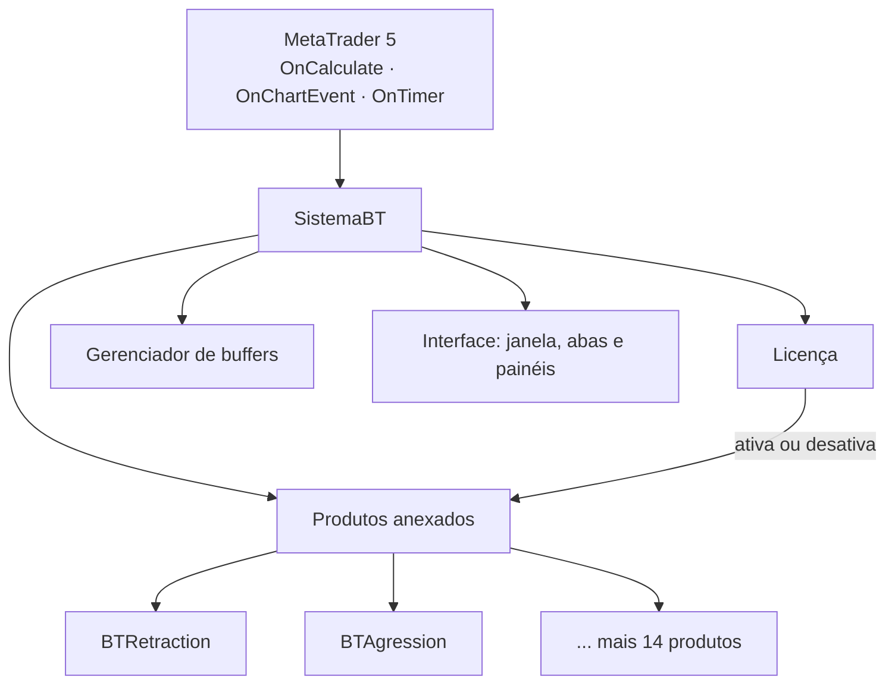
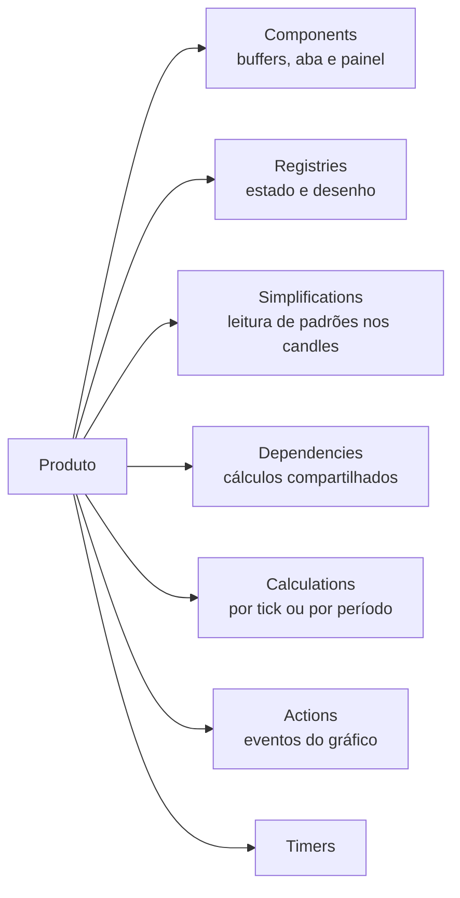
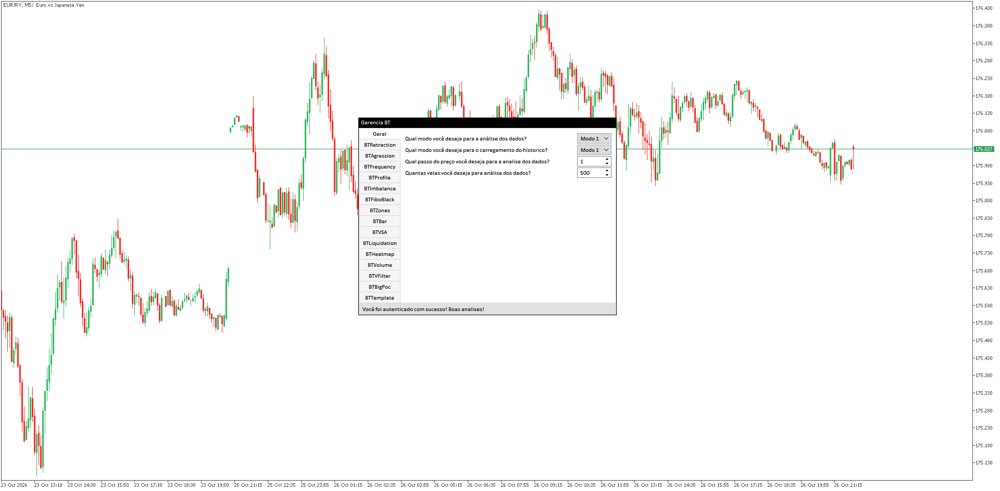
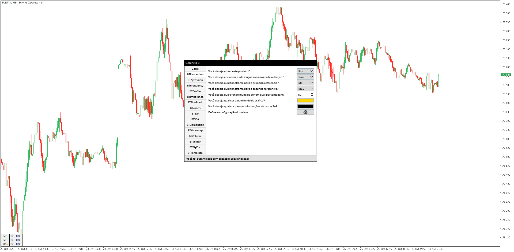
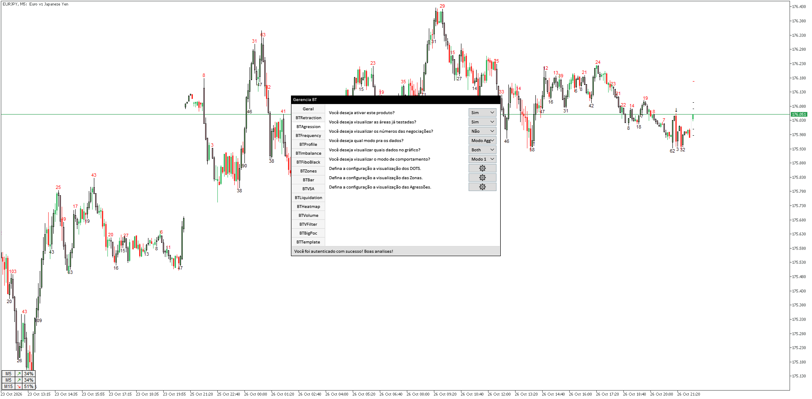
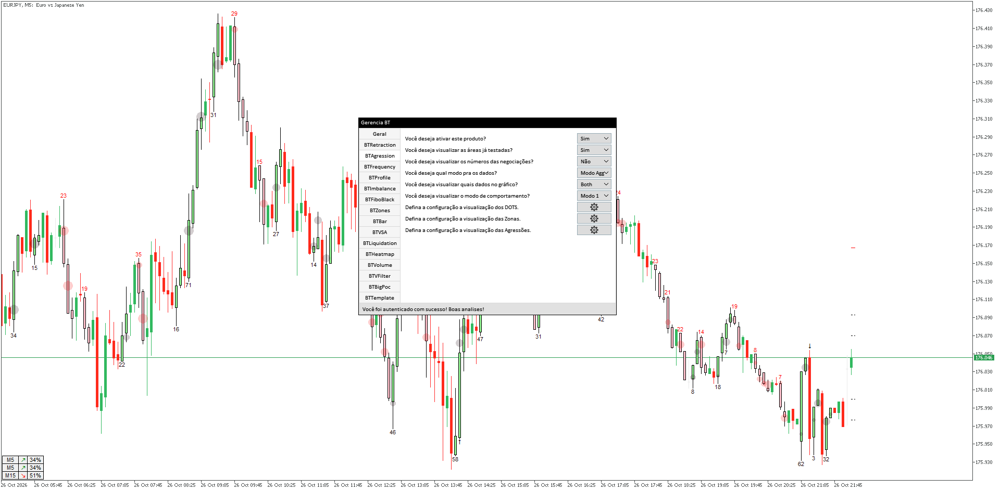
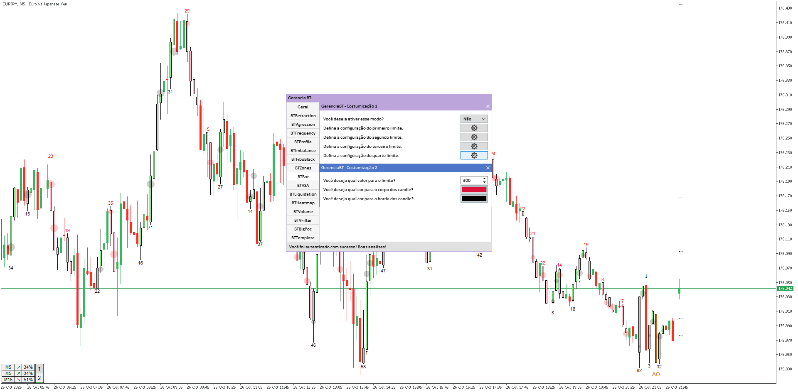

# GerenciaBT - Arquitetura

Indicador para MetaTrader 5 que reúne 16 ferramentas de análise de volume e fluxo em um só arquivo, usado pelos assinantes de uma plataforma de trading. Feito em MQL5, sem IA, entre o fim de 2024 e 2025, com ajustes até hoje.

> O código é privado, porque o produto é de um cliente. Aqui mostro o problema, a arquitetura e o produto funcionando.

## Em números

| O que | Quanto |
| --- | --- |
| Ferramentas de análise | **16**, cada uma um produto |
| Código dos produtos | cerca de **11 mil linhas** |
| Framework próprio por baixo | cerca de **10 mil linhas** |
| Buffers de dados | **200**, desenhados em 24 plots |
| Builds por processador | **4** (x64, AVX, AVX2 e AVX-512) |

## O problema

Cada ferramenta era um indicador separado. O cliente tinha que instalar e atualizar vários arquivos, cada um com sua própria configuração, e liberar uma ferramenta nova para um plano exigia mandar um arquivo novo para cada assinante.

## A solução: um framework de produtos

Escrevi um framework em MQL5, o SistemaBT, e cada ferramenta virou um **produto** que se encaixa nele. O indicador em si é pequeno: ele só cria o sistema e anexa os produtos. Todo o resto (ciclo de vida, buffers, eventos, timers, interface e licença) é do framework.



### Anatomia de um produto

Todo produto segue o mesmo contrato. Ele declara o que precisa, e o framework cria, chama e destrói cada peça na hora certa:



- **Calculations:** cada etapa de cálculo é uma classe própria (`CalculateA`, `CalculateB`...), que roda a cada tick ou a cada novo candle e guarda até onde já processou.
- **Actions:** cada reação a evento do gráfico (rolagem, zoom, clique, evento interno do sistema) é uma classe própria (`ActionA`, `ActionB`...).
- **Timers:** tarefas com intervalo próprio, ligadas e desligadas pelo próprio produto.
- **Registries:** guardam o estado e cuidam do desenho no gráfico.
- **Simplifications:** encontram padrões e sequências nos candles e entregam prontos para os cálculos.
- **Dependencies:** cálculos que vários produtos usam (ZigZag, VSA, Bandas de Bollinger, volume) ficam num lugar só, em vez de cada produto calcular de novo.
- **Components:** cada produto declara os próprios buffers e a própria aba de configuração.

### Buffers

No MetaTrader, um indicador declara na compilação quantos buffers e plots vai usar, e cada um é ligado a um índice fixo. O comum é numerar tudo à mão (buffer 0, buffer 1...), o que fica impraticável com 16 ferramentas e 200 buffers, e quebra toda vez que uma ferramenta entra ou sai.

No GerenciaBT, buffer é um objeto. Cada produto declara os buffers de que precisa e de que tipo são, e o framework cuida do resto:

- **Índices automáticos:** o framework distribui os índices entre os produtos, na ordem que a plataforma exige, e confere o total contra o limite declarado antes de criar.
- **Configuração automática:** cada plot já nasce configurado, com tipo de desenho, cores e o nome do produto na janela de dados.
- **Atualização só do necessário:** quando chega um candle novo, só as posições novas são preparadas, sem limpar o histórico.
- **Candles disputados:** quando dois produtos querem pintar o mesmo candle, a prioridade decide qual aparece. Se o produto que estava na frente sai, o próximo volta a aparecer sozinho, sem recalcular nada.
- **Acesso simples:** dentro de um produto, ler e escrever num buffer é como usar um array comum.

Para quem escreve um produto novo, buffer deixa de ser um problema: é só declarar.

#### Uma sacada de linguagem: `operator[]` para ler e escrever

Em C++, um `operator[]` que devolve uma referência (`double&`) serve tanto para ler quanto para escrever. Em MQL5 não dá: a linguagem não deixa um método devolver referência para um tipo primitivo. Então `buffer[i] = valor` não funciona num objeto, só num array puro.

A saída foi sobrecarregar o operador pelo **tipo do índice**: com `int`, ele devolve o próprio objeto, que guarda o índice e sobrecarrega o `operator=`; com `uint`, devolve o valor. Dois apelidos deixam a intenção clara no código:

```cpp
#define GET uint
#define SET int

class BufferArray {
private:
    SET     m_index;
public:
    double  m_buffer[];

    BufferArray* operator[](SET i)  { m_index = i; return &this; }  // escrita
    double       operator[](GET i)  { return m_buffer[i];        }  // leitura
    void         operator=(double v) { m_buffer[m_index] = v;    }
};

int i = 10;
buffer[i] = preco;               // índice int: escreve
double v = buffer[(GET)i];       // índice uint: lê
```

O resultado é que o buffer, que por trás é um objeto gerenciado pelo framework, se usa no produto quase como um array comum.

### Ciclo de vida

- **Ativar** um produto cria os módulos dele, liga os componentes e começa a calcular.
- **Desativar** para os módulos, destrói tudo o que eles criaram e apaga do gráfico os objetos do produto, sem afetar os outros.
- **Mudar uma configuração** reinicia só aquele produto, sem recarregar o indicador.

Com isso, criar uma ferramenta nova é escrever um produto seguindo o contrato, sem tocar nos outros 15. E a licença decide quais produtos ficam ativos para cada cliente, sem arquivo novo.

### Interface

A janela, as abas e os controles usam a biblioteca EasyAndFastGUI como base, que eu adaptei para o GerenciaBT:

- Um controle novo (botão com rótulo) e janelas de customização que abrem uma sobre a outra.
- Abas que avisam o produto quando aparecem ou somem, para mostrar e esconder só o conteúdo da aba aberta.
- Liberação dos recursos gráficos quando uma janela é fechada.
- Um mapa de eventos para ligar cada controle ao seu tratamento de forma declarativa.
- Correções de erros da biblioteca que apareciam no uso real.

## Desempenho: o caso do BTAgression

O MetaTrader redesenha o gráfico a cada tick, rolagem e zoom, e o indicador precisa acompanhar sem travar a plataforma do cliente. Boa parte do meu trabalho no GerenciaBT foi reescrever partes que funcionavam, mas pesavam.

O BTAgression é o melhor exemplo. A primeira versão fazia a tela piscar (flicker) e, com muitas marcações no gráfico, gerava atraso a cada movimento. Repensei a forma de desenhar do zero: hoje o módulo mostra o gráfico cheio de marcações sem piscar, e rolar ou dar zoom no gráfico não pesa no indicador.

## Por baixo: cache, cálculo incremental e memória

A mesma preocupação vale para o framework inteiro:

- **Nada é calculado duas vezes:** o indicador processa só o que mudou desde o último tick.
- **Nada é desenhado sem necessidade:** o que não mudou ou não está na tela não é redesenhado.
- **Controle de memória:** MQL5 não tem coleta de lixo para objetos criados com `new`, então escrevi estruturas que cuidam sozinhas do ciclo de vida dos objetos.

## A licença

Cada indicador só funciona depois de autenticado no servidor da plataforma, e a licença fica vinculada à máquina do cliente. Toda a comunicação é protegida por uma camada criptográfica que eu desenhei, e que evoluiu em 6 versões, cada uma fechando uma brecha encontrada em produção. O lado do servidor está no [SistemaBT](https://github.com/jaumprogamador/sistemabt).

## Um build por processador

O mesmo código é compilado em 4 versões (x64, AVX, AVX2 e AVX-512). A atualização automática pergunta ao servidor qual build serve para o processador do cliente e entrega o mais rápido que a máquina suporta.

## Telas

Indicador em uma conta demo, no EURJPY de 5 minutos.

**Painel:** a janela do GerenciaBT, com uma aba para as configurações gerais e uma para cada módulo. A barra de baixo mostra que a licença foi autenticada.



**BTRetraction:** configuração do módulo de retração, com dois timeframes de referência. A tabela no canto inferior esquerdo mostra a direção e a porcentagem em cada timeframe.



**BTAgression:** com o módulo ligado, o gráfico ganha os números e as marcações de agressão em cada ponto de virada.



**No gráfico:** mais de perto, os pontos (DOTS), as áreas já testadas e os números de agressão sobre os candles.



**Customização:** as janelas de configuração abrem uma sobre a outra. Aqui, os limites de um módulo e, em cima, a cor e o valor de um desses limites.



## Stack

MQL5 · programação orientada a objetos · interface gráfica própria · integração com servidor próprio (Python)
